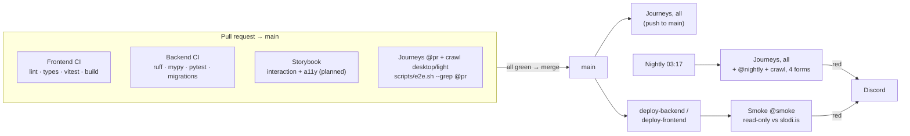

# Journey tests in CI

> Recommendation · 2026-10-11 · builds on `docs/storybook-and-journeys.md`

**In short.** Every PR runs the key user journeys in a real browser against
the real backend and database, using fixed seed data. The run takes about
4–5 minutes in GitHub Actions.

- **Stack.** One `docker compose` file brings up Postgres, migrations, a
  deterministic seed and the production backend image. The frontend is built
  and started on the runner.
- **Auth0.** It is never contacted. Each run generates its own signing key. The
  backend accepts that key only when `ENV=e2e`, and refuses to start if the key
  is configured anywhere else. The tests write the Auth0 SDK's own session
  cookie with the SDK's own testing helper, so the frontend has no test code
  path at all.
- **Traceability.** User stories → `docs/journeys/<slug>.md` → one Playwright
  test per journey, tagged with story ids. A report in the job summary shows
  which stories are proven, failing or uncovered.
- **Prototype.** It runs today. On `main`, "Program Owner edits from the bank"
  fails at step S5 (the leiðbeiningar are gone), which is sc-530.
  - Only that step is marked as an expected failure. The suite stays green, but
    a failure at any other step is still red.
  - It goes red if the fix lands without removing the marker.

## 1. Traceability: story → journey → test

Format and rules: [`journeys/README.md`](journeys/README.md). In outline:

| Layer | Where | Id |
|---|---|---|
| User story | `docs/tharfagreining2/user-stories.md` | `B4`, `E2`, ... (cluster letter + number, already stable) |
| Bug | Shortcut | `sc-530` |
| Design criterion | `docs/design/<x>/SPEC.md` §10 | cited by name today. Proposal: number the criteria (`yfirferd#AC5`) |
| Journey | `docs/journeys/<slug>.md` | `<slug>`, steps `S1…Sn`, never renumbered |
| Test | `frontend/e2e/journeys/<slug>.journey.ts` | tags `@journey:<slug>`, `@story:<id>`, `@pr`/`@nightly`; `step("S3", …)` |

The journey's front matter lists the stories it proves. The test repeats them
as tags, and the report warns when the two drift apart. An open bug that a
journey hits is marked on the step it breaks, `knownBugStep("sc-530", "S5", …)`,
not as a tag. The marker becomes a `test.fail` only if that step fails.

**Report** (`frontend/e2e/support/coverage-report.mjs`). It runs after every
CI run and is written to the job summary. It has three parts:

- **Journey table.** Result, the step a failing journey stopped at, and the
  known issue.
- **Story table.** Each story's worst journey result: ✅ passing, 🟠 known bug,
  ❌ failing, 🟡 flaky, 📝 not automated.
- **Count and warnings.** How many stories are proven, covered or uncovered,
  plus warnings for journeys that prove no story and for tag drift.

The first run already shows two gaps:

- **No story for the review team.** Yfirferð is built and in use, but
  `user-stories.md` has no story for the people who use it. The
  reviewer-sweeps-yfirferd journey hangs off E5.
- **No story about keeping what you wrote.** No story covers instructions or
  documents surviving an edit. B4 is the closest.

Both are þarfagreining work, and the report keeps them visible.

## 2. Test environment in the pipeline

| Option | Verdict |
|---|---|
| **docker compose on the runner** | **Chosen.** It uses the same images as production (`backend/Dockerfile`, target `production`), needs no infrastructure, and a fresh database every run. It costs about 1–2 minutes of image build. |
| GitHub service containers | Fine for Postgres alone (the `migrations` job uses them). They can't run migrations or the seed as ordered steps, or wait on health checks, so the setup moves into YAML. A second way to run the stack drifts. |
| Deployed preview environment | Closest to production, but Slóði has one Azure VM and no per-PR infrastructure. It would need per-PR databases, DNS and teardown, and Auth0 callback URLs. Revisit only if journeys need things compose can't provide (real blob storage, email). |

**Shape** (`docker-compose.e2e.yml`, `scripts/e2e.sh`):

- **Separate project.** The compose file is standalone with project name
  `slodi-e2e`. No `container_name`s, Postgres is not exposed, the backend is
  on :18000 and the frontend on :13000. It runs alongside a dev stack.
- **Database.** Postgres runs on `tmpfs`, so every run starts empty.
- **Seed.** `seed` runs `alembic upgrade head`, then `scripts/seed_e2e.py`.
  This is a separate seed from `seed.py`:
  - fixed UUIDs, names and timestamps;
  - one fixture item per journey;
  - refuses to run unless `ENV=e2e`.

  `frontend/e2e/support/fixtures.ts` is its other half.
- **Frontend.** Built with `next build` on the runner, and started by
  Playwright's `webServer` with `next start`. It is a production build, not
  `next dev`, so there is no compile-on-first-hit flake and the result matches
  what is deployed.

### Auth0

How it works today:

- `middleware.ts` asks the SDK for a session, which is an encrypted `__session`
  cookie.
- `/api/auth/token` hands the access token from that session to the browser.
- The backend's `verify_auth0_token` checks it against Auth0's JWKS.
- Backend unit tests skip all of this with
  `app.dependency_overrides[get_current_user]`, which only works inside the
  test process.

| Option | Security | Fidelity | Verdict |
|---|---|---|---|
| Test-only bypass (e.g. `X-Test-User` header, or a `get_current_user` override behind a flag) | A flag that turns off authentication sits in the production image. One misconfiguration and anyone is anyone. | Skips signature, audience and expiry checks, the frontend token route, and user auto-creation. | No |
| Auth0 test tenant with test users | No new code path. It needs secrets in CI and real passwords, and fork PRs can't use them. | Highest, including the login page. | Too slow and brittle for every PR: Auth0 rate limits, and its UI changes break tests. **Use it for production smoke only** (§4). |
| **Mint JWTs from a per-run local key** | Production code is unchanged except where it reads keys from. The key exists for one run. The switch is refused outside `ENV=e2e`. | Full verification path: signature, `aud`, `iss`, `exp`, user auto-creation from claims, and the real SDK cookie and middleware. Only the Auth0 login page is not exercised. | **Chosen** |

How the chosen option works:

1. `e2e/support/generate-keys.mjs` makes an RS256 key pair for the run in
   `frontend/e2e/.auth/` (gitignored). The public JWKS is mounted into the
   backend, and `AUTH_TEST_JWKS_FILE` points at it.
2. `JWKSCache._fetch` reads that file instead of
   `https://$AUTH0_DOMAIN/.well-known/jwks.json`. Nothing else in
   `verify_auth0_token` changes.
3. The `signInAs(persona)` fixture signs an access token with
   `sub = e2e|program-owner`. It wraps the token in a session using
   `generateSessionCookie` from `@auth0/nextjs-auth0/testing`, the SDK's
   supported helper, and the `AUTH0_SECRET` that `next start` was given, then
   sets it as `__session`.

Why it can't reach production:

- **Allowlist guard.** `Settings` refuses to load if `AUTH_TEST_JWKS_FILE` is
  set and `ENV` is not `e2e`. It is an allowlist, so `production`, `staging`, a
  typo or an empty value all fail closed. The process never starts. This is
  covered by `backend/tests/test_auth_test_jwks.py`, which also checks that a
  token from any other key, a wrong audience or an expired token is still
  rejected.
- **The variable alone is useless.** Even with `ENV=e2e` forced, an attacker
  also needs a file of keys inside the container. No key is committed or stored
  as a secret.
- **The frontend has no test code.** Making a session cookie needs
  `AUTH0_SECRET`, which is already true of production.

## 3. Tooling

**Playwright, plain TypeScript, no Gherkin.** playwright-bdd would make the
steps read like the stories. But the readable layer already exists: the
journey file, which non-developers write and review in Markdown. Gherkin would
add a second copy of the same steps, a step-definition registry to keep in
sync, and a build step. Using `step("S3", "Changes the title and saves")`
ties the code to the journey file with less machinery. Revisit if
Dagskrárstjórnarteymið or þarfagreining start writing tests themselves.

**Where the tests live: `frontend/e2e/`, not a separate package.** The cookie
must be made by the exact `@auth0/nextjs-auth0` version the app runs, so it
belongs on the same lockfile. It also shares the Node version, the npm cache in
CI, Prettier and ESLint, and the `@/` paths. Files are `*.journey.ts`, so
Vitest's `*.spec`/`*.test` glob never picks them up.

**Time budget.**

| Stage | Local (measured, warm caches) | GitHub runner (estimate) |
|---|---|---|
| Backend images build | a few seconds cached, ~1 min cold | ~90 s cold, ~30 s with GHA layer cache |
| Migrate + seed + backend healthy | ~10 s | ~15 s |
| `next build` | ~25 s | ~90 s |
| The journey (Playwright, incl. `next start`) | 13 s | ~20 s |
| **Total, `scripts/e2e.sh --grep @pr`** | **58 s** | **~4–5 min** including `npm ci` and the browser install |

- **Budget for the PR gate: 8 minutes.** It runs in parallel with Frontend CI,
  which already takes about as long because of its own `next build`.
- **About 10–15 PR-gated journeys fit in that budget.** Everything else, and
  anything slow (the Yfirferð sweep, phone viewport variants), is `@nightly`.
- **When the gate passes 8 minutes,** first share the `next build` with
  frontend-ci as an artifact, then shard Playwright.

**Flake control.**

- **Deterministic data.** Every journey owns its fixture rows, and the clock,
  locale and timezone are pinned in the config.
- **No sleeps.** Only web-first assertions (`toBeVisible`, `toHaveText`).
- **One retry in CI, never locally.** A test that passes on retry is reported
  🟡 *flaky* in the report and Playwright output. It is not a pass. A flaky
  journey gets a Shortcut ticket within the week, or moves to `@nightly`.
- **`workers: 1` for now.** Raise it once there are enough journeys to be
  worth it; each owns its own rows, so they can run in parallel.

**Artefacts.**

- On failure: trace, video and screenshot (`retain-on-failure`).
- Always: the HTML report and `results.json`.
- All of it is uploaded as one artifact, kept for 14 days. A trace opens at
  `trace.playwright.dev`, with DOM snapshots and network calls for each step.

**Storybook interaction tests.** These are the layer below journeys.

- **A component state or interaction belongs in Storybook,** for example
  "`ConfirmDialog` refuses without a reason" or "the card shows a filled heart
  when `liked`". These checks are fast and need no backend.
- **A journey checks what only the whole system shows:** data surviving a
  round trip, a count agreeing across pages, permissions.
- **Where they meet.** A journey step that fails points at a component, and that
  component's stories should then reproduce the state. sc-530 is a data-flow
  bug: a list summary was used as edit input. Storybook could not have caught
  it, and a journey did.

## 4. Gates

**Blocks a PR merge** (required checks):

- the existing Frontend CI and Backend CI jobs;
- `Journeys (PR gate)`: every `@pr` journey passes or is a marked known bug.
  "Expected to fail but passed" also blocks, so a fixed bug's marker gets
  removed in the PR that fixes it.

`journeys.yml` runs on PRs that touch `frontend/`, `backend/`, `docs/journeys/`
or the e2e files. A required check that is skipped by path filters blocks the
merge in GitHub, so either make it required without path filters, or keep it
advisory until Phase 2.

**After deploy, against production (read-only, `@smoke`)** — not built yet:

- **Signed out.** Front page, `/about` and `/leikir` load. `/programs`
  redirects to Auth0 login. `/api/config` returns the bank id. The backend
  `/healthz` returns 200.
- **Signed in.** A dedicated smoke account in the real Auth0 tenant logs in
  through the real login page, opens the bank, opens a known item and checks
  that the like count and leiðbeiningar render. It doesn't like, comment, edit
  or submit anything.

The smoke tests run from a `workflow_run` trigger after
`deploy-frontend`/`deploy-backend` succeed. They use the same Playwright
config with `baseURL` set to production and `--grep @smoke`. Smoke tests may
only read: they must not like, comment, edit or submit, because these are the
only tests that touch real data. This is the only place the Auth0 test-tenant
option earns its keep.

Secrets the smoke job will need: `SMOKE_BASE_URL`, `SMOKE_AUTH0_USERNAME`,
`SMOKE_AUTH0_PASSWORD`. The smoke account is a plain viewer with MFA disabled
and an Auth0 rule restricting it to the smoke runner if possible.

**Nightly:**

- all journeys, including `@nightly`;
- later, a phone-viewport project and a run against the current production
  data shape (anonymised dump).

A red nightly posts to Discord.

## 5. Route crawler

Journeys prove a few tasks end to end. The crawler (`frontend/e2e/crawl/`)
covers breadth: it opens **every page under `app/`** as every persona, in
every form, on the same stack and seed.

- **Pages.** `routes.ts` reads `app/**/page.tsx`. A dynamic route
  (`/programs/[id]`) is filled from the e2e seed: one path per kind of page it
  can render (a task, a program and an event with instructions, documents
  and likes; an unreviewed and a hidden item; a devlog; a Heiðursorðla round).
  A dynamic route it can't fill goes in `SKIP` with a reason. `routes.test.ts`
  runs with `npm test` and fails on a new dynamic route that is in neither.
- **Personas.** Signed out, member (`e2e|community-member`), editor
  (`e2e|editor`, bank editor with a workspace of her own) and admin
  (`e2e|admin`).
- **Forms.** Playwright projects `crawl-{desktop,phone}-{light,dark}`. Phone
  is 390px. The theme is set the way the app reads it: `slodi-theme` in
  localStorage, plus `prefers-color-scheme`.
- **Fails on.** An uncaught error or `console.error`; an API (or app route)
  response ≥ 400; horizontal overflow at phone width; leftover English UI
  words (`english.ts`, a short, case-sensitive denylist that skips code and
  anything marked `translate="no"` or `data-user-content`). A signed-out visit
  to a private page (`lib/route-access.ts`) asserts the redirect to log in
  instead.
- **axe** runs on every page but is report-only: violations are annotations
  and an `axe-violations.json` attachment, summarised in the job summary.
- **Expected failures** are declared in `expectations.ts`, per route and
  persona, with the reason: an admin page's 403 for a member, a hidden item's
  404 for someone who may not see it. A tolerated bug names its Shortcut story
  and matches only its own message; the summary lists every one it saw.
- **Report.** `e2e/support/crawl-report.mjs` adds a "Route crawl" section to
  the job summary: results per form, every finding, tolerated bugs and the
  axe rules.

The PR gate crawls desktop + light (`--project crawl-desktop-light`), every
persona. Nightly, pushes to `main` and manual runs crawl all four forms.

## Costs

| Item | Cost |
|---|---|
| GitHub Actions minutes | The repo is public, so standard runners are free. If it went private: about 5 min per PR run plus 30 nightly runs a month, roughly 400–800 min/month, which fits in the free 2,000. |
| Artifacts | Traces and video only on failure, 14-day retention. Under 50 MB per failing run. |
| Auth0 | Nothing for PR and nightly. One extra user in the production tenant for smoke. |
| People | A journey file is about 30 min of þarfagreining or design time. A test is 1–2 h at first, then about 30 min once the fixtures exist. Keep the PR gate under 15 journeys. |

## Risks

| Risk | Mitigation |
|---|---|
| The test key switch reaches production | Allowlist guard plus unit test. A key file is also needed. No key is stored anywhere. |
| Flaky journeys get ignored, and then the gate does | One retry, flaky shown as its own status, a ticket or a move to nightly within a week. |
| Seed and tests drift apart | Ids live in two small files that point at each other. A changed seed runs every journey in the same PR. |
| Auth0 SDK upgrade changes the cookie format | The cookie is made by that SDK's own helper from the same lockfile, so an upgrade carries it along. |
| The e2e stack differs from production (no Azure blob storage, no Resend, Next on the host instead of in Docker) | Journeys avoid uploads and email for now. Production smoke covers the real wiring. Move the frontend into compose if a difference ever bites. |
| The suite gets slow and people start skipping it | 8-minute budget. Anything beyond it moves to nightly. |
| Journey files go stale | Each SPEC change names the journeys it touches (proposal §2). The report shows journeys without tests and stories without journeys. |

**Already found.** The first fresh build of the e2e stack failed because
`backend/Dockerfile` ran an unlocked `uv sync` (`.dockerignore` excluded
`uv.lock`). That put SQLAlchemy 2.1 without greenlet into the image while CI
tested 2.0.45. Production only works because that Docker layer is cached. The
fix is on this branch as its own commit.

## Rollout

**Phase 1: prototype (this branch)**

- [x] `docs/journeys/` format plus three journeys
- [x] Per-run signing key, `AUTH_TEST_JWKS_FILE` guarded to `ENV=e2e`, unit tests
- [x] `seed_e2e.py`, `docker-compose.e2e.yml`, `scripts/e2e.sh`
- [x] Playwright in `frontend/`, "Program Owner edits from the bank" (sc-530 as a known bug)
- [x] Coverage report, `journeys.yml`
- [x] Backend image builds from `uv.lock`

**Phase 2: make it a gate**

- [ ] Merge, watch `Journeys` on 10 PRs as an advisory check
- [x] Implement community-member-likes-and-shares (sc-531 as a known bug)
- [ ] Turn S5's `knownBugStep` back into `step` in the sc-530 PR. The run forces this.
- [ ] Make `Journeys (PR gate)` a required check
- [ ] Cache backend image layers in GHA (`docker/build-push-action` with `cache-to: type=gha`)

**Phase 3: widen**

- [ ] Reviewer-sweeps-yfirferd (nightly), plus seed items for reject and send
- [ ] Journeys for sc-536 (deleting a task or event returns 404) and the other epic-529 bugs
- [ ] Number SPEC §10 criteria. Add a "Journeys" line to the `design-spec` template.
- [ ] Add the missing reviewer-role user story to `user-stories.md`

**Phase 4: production**

- [ ] Smoke account in Auth0. Add `@smoke` tests and a post-deploy `workflow_run` job.
- [x] Phone-viewport project, nightly (the route crawler's phone forms)

## Open decisions

1. **Auth approach.** Per-run local key (recommended), or also an Auth0 test
   tenant for PRs? The tenant would exercise the login page on every PR, at the
   cost of secrets, rate limits and no runs on fork PRs.
2. **PR versus nightly.** Is a 4–5 minute required check acceptable on every
   PR that touches `frontend/` or `backend/`? The alternative is advisory on
   PRs and blocking only on `main`.
3. **Preview environments.** Not recommended now. Revisit if journeys need
   real blob storage or email.
4. **Smoke on production.** OK to create a dedicated smoke user in the
   production Auth0 tenant and its database?
5. **Dockerfile fix.** Ship it as its own PR ahead of this one? It changes
   what production installs on the next uncached build, towards the versions
   CI already tests.
