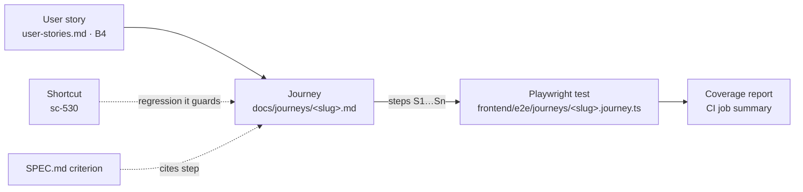

# Journeys

A journey follows one person through one task, end to end, in the words of
þarfagreining. Each journey here is the link between the user stories that ask
for something and the test that proves the product delivers it:



The reasoning, the CI setup and the rollout plan are in
[`../journey-testing-in-ci.md`](../journey-testing-in-ci.md).

## A journey file

One file per journey: `docs/journeys/<slug>.md`. The slug is the journey's id
and never changes once a test refers to it.

```markdown
---
id: program-owner-edits-from-bank
persona: Program Owner
stories: [B4, E2, E6]
shortcut: [sc-530]
specs: [efnissida]
test: frontend/e2e/journeys/program-owner-edits-from-bank.journey.ts
gate: pr
---

# Program Owner edits from the bank

One paragraph: who, what they are trying to do, and why it matters.

## Steps

| Step | The person… | They expect… |
|---|---|---|
| S1 | opens the dagskrárbanki and finds their item | to see their own item's card |
| S2 | … | … |
```

The front matter is read by a script, so keep each key on one line and lists
in `[a, b]` form.

| Key | Meaning |
|---|---|
| `id` | The slug. Must equal the file name. |
| `persona` | One of the personas below. |
| `stories` | Ids from [`tharfagreining2/user-stories.md`](../tharfagreining2/user-stories.md) (`B4`, `E2`, ...) that this journey proves. Empty means no story asks for it, which the report flags. |
| `shortcut` | Bugs this journey guards against. Bugs are not stories, so they are listed separately. |
| `specs` | `docs/design/<name>/SPEC.md` files whose acceptance criteria a step checks. |
| `test` | Path of the Playwright test, or `none` while it is still a manual journey. |
| `gate` | `pr` (blocks merge), `nightly`, or `smoke` (also runs read-only against production). |

### Step ids

- Steps are `S1`, `S2`, ... and are referred to as `<slug>#S3`, for example in
  a SPEC's "Journeys" line or a Shortcut story.
- **Never renumber.** A new step between S3 and S4 becomes `S3a`. A step that
  no longer applies is struck through and left in place, so old references
  still resolve.
- A step is a thing the person does and what they expect to see. Write it in
  their terms ("the leiðbeiningar are still there"), not the UI's ("the
  `#ef-leidbeiningar` section is non-empty").
- A step that cannot be automated yet, because the feature is not built or the
  check needs a human, is marked _(manual)_. The test skips it and the report
  counts the journey as covered but not proven.

## The test

The test lives at the path in `test:` and mirrors the file:

```ts
test("Program Owner edits an item from the bank ...", {
  tag: ["@journey:program-owner-edits-from-bank", "@story:B4", "@story:E2", "@story:E6", "@pr"],
  annotation: [{ type: "issue", description: "sc-530" }],
}, async ({ page, signInAs }) => {
  await signInAs(PERSONAS.programOwner);
  await step("S1", "Opens the dagskrárbanki and finds their own item", async () => { ... });
  ...
});
```

- `@journey:<slug>` ties the test to this file. There is one test per journey;
  variants (phone, signed out) are extra tests with the same journey tag.
- `@story:<id>` repeats the `stories:` list. The report warns when they drift
  apart.
- `@pr` or `@nightly` mirrors `gate:`. CI selects on these tags.
- `step("S3", ...)` uses the step id from this file. When a test fails, the
  report shows which step it stopped at, which is the step the person could not
  complete.
- A step that a known open bug breaks is written
  `knownBugStep("sc-NNN", "S5", ...)` instead of `step(...)`.
  - **Scoped to that step.** A failure in that step becomes `test.fail`, an
    expected failure, so the suite stays green while the bug is open. A failure
    in any other step still fails the run. A test-wide `test.fail` would also
    hide a broken fixture at S1 and call it the known bug. That happened on the
    first run of this prototype.
  - **The fix has to remove it.** When the step starts passing, the test fails
    with "sc-NNN looks fixed". The fix PR then changes it back to `step(...)`,
    so a known bug can't be closed silently.

## The coverage report

`frontend/e2e/support/coverage-report.mjs` joins `user-stories.md`, these files
and the Playwright results. CI writes its output to the job summary;
`scripts/e2e.sh` writes it to `frontend/e2e-results/coverage.md`.

| Result | Meaning |
|---|---|
| ✅ passing | Every journey that proves this story passed. |
| 🟠 known bug | A journey fails at a step marked `knownBugStep` with a Shortcut id, and only there. |
| ❌ failing | A journey failed. The report shows the step it stopped at. |
| 🟡 flaky | It passed only on retry. This counts as a failure to fix, not a pass. |
| 📝 not automated | The journey is written, but `test: none`. |
| uncovered | No journey lists this story. |

A story counts as proven only when **every** journey that lists it passes.

## Personas

These come from [`frontend/program-detail-page-improvements.md`](../frontend/program-detail-page-improvements.md#-user-journeys)
and the roles in `user-stories.md`. Each one maps to a seeded account in
`backend/scripts/seed_e2e.py`.

| Persona | Who | Seeded account |
|---|---|---|
| Program Owner | Sigurður, a foringi who has put his own items in the bank | `e2e\|program-owner`, member, bank viewer, author of the fixture items |
| Community Member | Anna, a foringi from another troop, browsing for ideas | `e2e\|community-member`, member, bank viewer |
| Reviewer | One of Dagskrárstjórnarteymið, sweeping new submissions | `e2e\|reviewer`, moderator |

## Journeys

| Journey | Persona | Stories | Gate | Test |
|---|---|---|---|---|
| [program-owner-edits-from-bank](program-owner-edits-from-bank.md) | Program Owner | B4, E2, E6 | pr | automated |
| [community-member-likes-and-shares](community-member-likes-and-shares.md) | Community Member | E4, J4 | pr | not yet |
| [reviewer-sweeps-yfirferd](reviewer-sweeps-yfirferd.md) | Reviewer | E5 | nightly | not yet |

## Who writes them

A journey comes out of þarfagreining and design, not out of code. Whoever
writes or changes a user story, or a `SPEC.md`, writes or updates the journey
it changes. The test follows in the PR that builds the feature. A journey PR
with no test is fine: the report shows it as "not automated", which is the
honest state.
